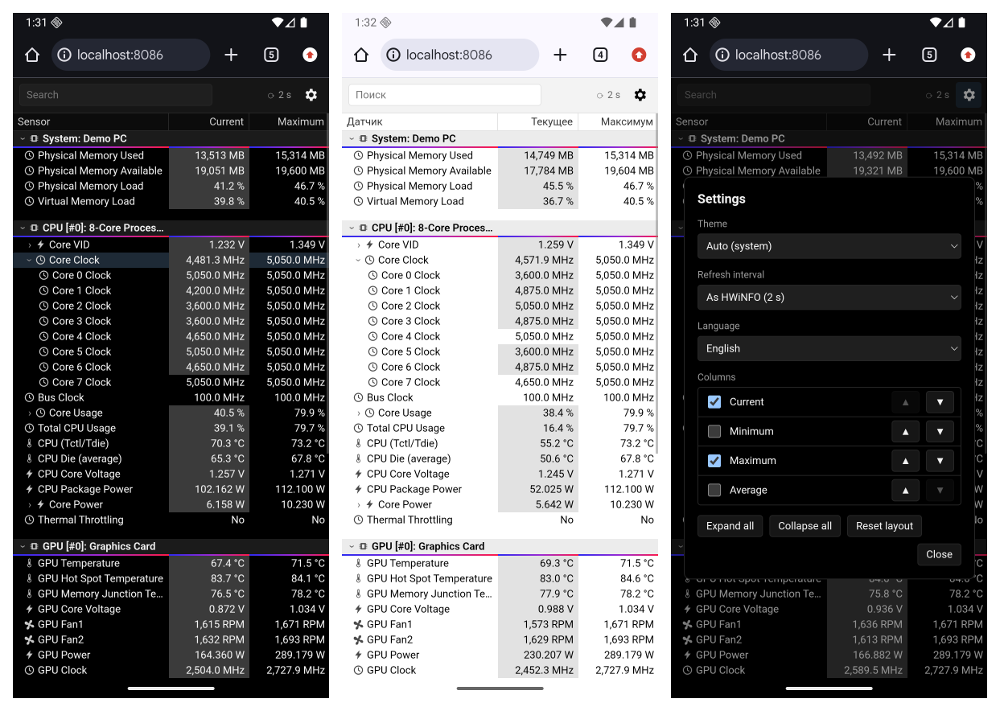
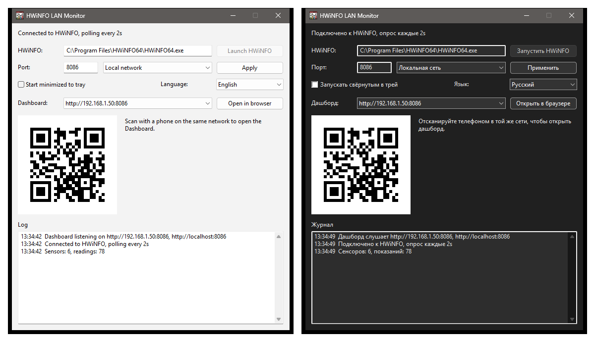

# HWiNFO LAN Monitor

[English](README.md) | **Русский**

Следите за датчиками ПК с телефона. HWiNFO LAN Monitor берёт данные сенсоров из [HWiNFO](https://www.hwinfo.com/) и показывает их быстрой веб-страницей в локальной сети. Температуры, частоты и обороты вентиляторов видны на телефоне или планшете, и для этого не нужно выходить из игры или что-то сворачивать.



## Зачем

- **Сделано для телефона.** Плотная таблица в стиле HWiNFO помещается на 6-дюймовый экран в портретной ориентации. Поверните телефон, чтобы увидеть все столбцы.
- **Выглядит как HWiNFO.** Сенсоры, сворачиваемые группы (частоты, загрузка, мощность по ядрам...), столбцы Текущее / Минимум / Максимум / Среднее.
- **Не нагружает систему.** Один небольшой `.exe` без установки и без рантаймов. Страница обновляет только изменившиеся ячейки и замирает, когда экран телефона выключен.
- **Нечего настраивать.** Запустили, отсканировали QR-код, готово.

## Быстрый старт

1. В HWiNFO откройте **Settings** и включите **Shared Memory Support**. Окно сенсоров держите открытым или свёрнутым.
2. Скачайте `hwinfo-lan-monitor.exe` из [Releases](../../releases) и запустите.
3. Отсканируйте телефоном QR-код в окне программы или откройте один из указанных адресов в любом браузере той же сети.



Закрытие окна сворачивает программу в трей (снимите галочку "Сворачивать в трей при закрытии", чтобы крестик закрывал программу). Выход через меню иконки в трее.

### Телефон не открывает страницу

Windows Firewall по умолчанию блокирует входящие подключения. Разрешите порт один раз из PowerShell **от администратора**:

```powershell
.\scripts\firewall-rule.ps1
```

Правило открывает TCP 8086 только для частных (домашних) сетей. Убрать его: `-Remove`, другой порт: `-Port <n>`.

## Возможности

**Дашборд** (настройки под шестерёнкой, хранятся в каждом браузере отдельно):
- Тема: Авто (как на устройстве), Светлая, Тёмная.
- Частота обновления: как опрашивает HWiNFO или реже.
- Язык: русский, английский.
- Столбцы: показать, скрыть, переставить (стрелками или перетаскиванием заголовков на ПК).
- Раскрытые сенсоры и группы запоминаются. Поиск фильтрует показания по имени.
- Изменившиеся значения подсвечиваются, как в HWiNFO.

**Окно программы** (настройки в `config.json` рядом с exe):
- Порт и режим доступа: локальная сеть или только этот ПК.
- Путь к HWiNFO определяется сам или задаётся кнопкой "Обзор..."; кнопка запускает HWiNFO, если он не запущен.
- Запуск свёрнутым в трей, сворачивание в трей при закрытии, язык.
- Повторяет светлую или тёмную тему HWiNFO. Запоминает своё место на экране.

## Полезно знать

- **Бесплатная версия HWiNFO** выключает shared memory через 12 часов. Включите её снова в настройках HWiNFO, монитор переподключится сам. Если включили при уже запущенном HWiNFO и ничего не произошло, перезапустите HWiNFO.
- **Частота опроса** задаётся в HWiNFO (Settings, Sensors). Монитор её показывает, но изменить не может.
- **Группы** вроде "Core Clocks" HWiNFO не публикует, поэтому монитор собирает их сам по именам показаний ("Core 0 ...", "Core 1 ..."). Названия могут немного отличаться от HWiNFO.
- **Min / Max / Average** берутся из HWiNFO, сбросить их можно только там.
- **Новые версии HWiNFO** должны работать: формат shared memory всегда только дополнялся в конце, а программа ориентируется на размеры, которые сообщает HWiNFO.

## Сборка

Нужны PowerShell 7, Go 1.27+ и go-winres (иконка и манифест):

```powershell
go install github.com/tc-hib/go-winres@v0.3.3
.\scripts\build-release.ps1          # vet, тесты, ресурсы, dist\hwinfo-lan-monitor.exe
.\scripts\run-dev.ps1                # сервер без окна на :8086 для разработки
```

Если Go нет в `PATH`, положите рядом со скриптами свой `scripts\env.ps1`, скрипты подключат его сами.

Для скриншотов и разработки без HWiNFO есть синтетические датчики: `hwinfo-lan-monitor.exe -demo dark` (или `-demo light`).

## Релизы

Релизы запускаются вручную на GitHub: **Actions → Release → Run workflow**. Выберите, какую часть версии увеличить (patch, minor, major), или впишите точную версию. Пайплайн собирает и тестирует на Windows, ставит тег `vX.Y.Z` и публикует GitHub Release с exe и его SHA-256.
